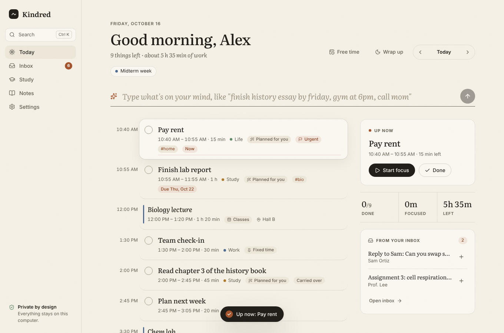
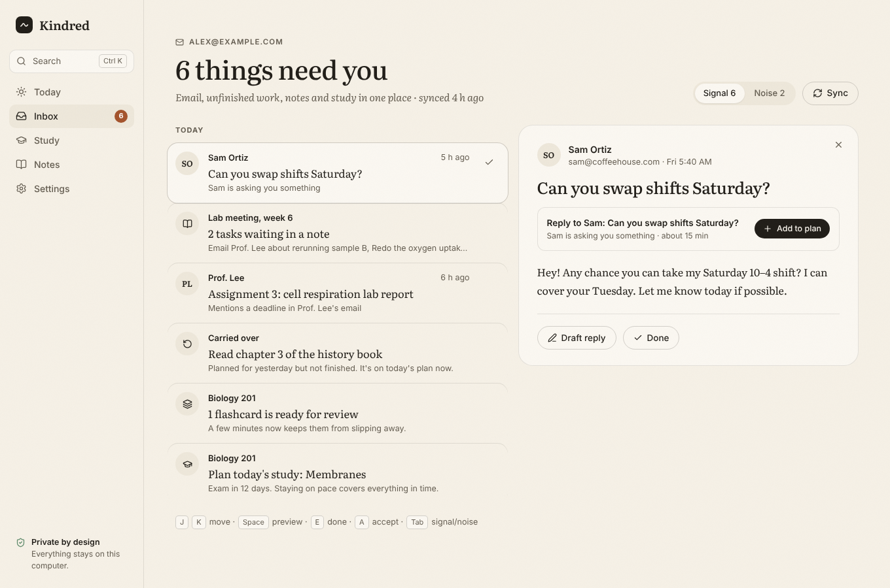
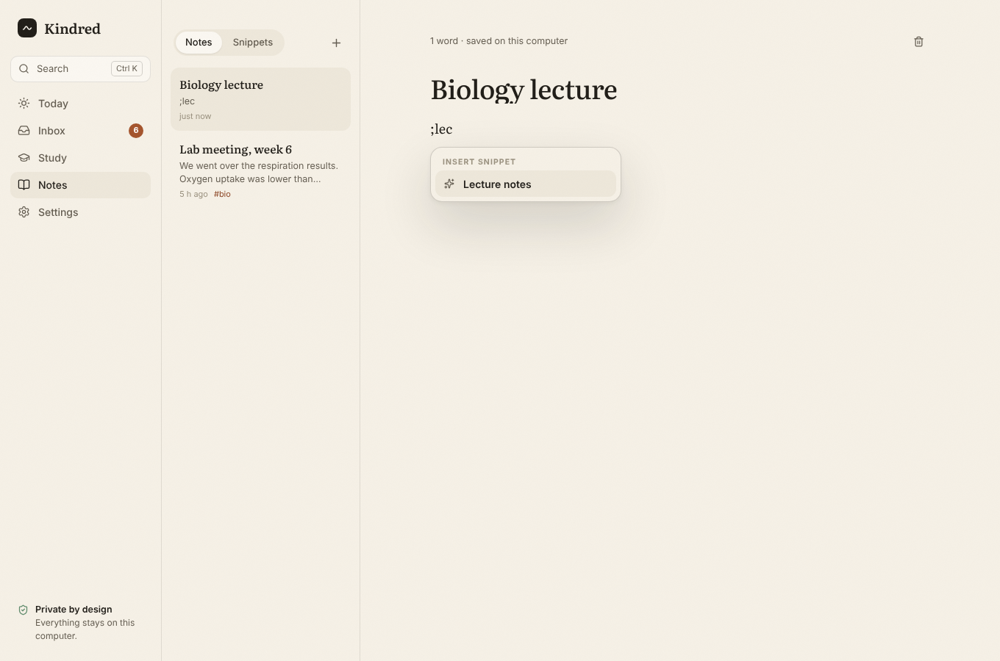
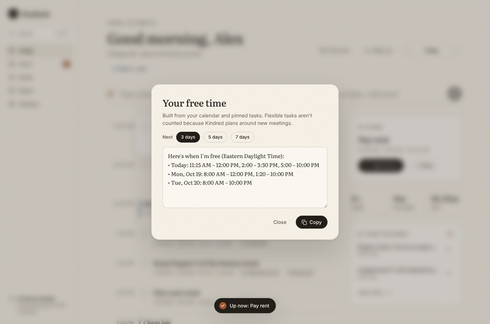
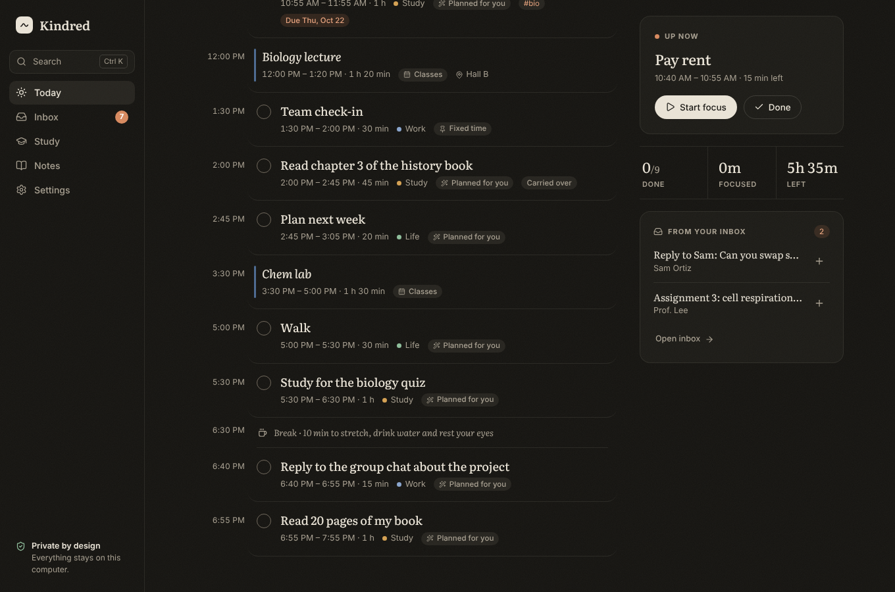
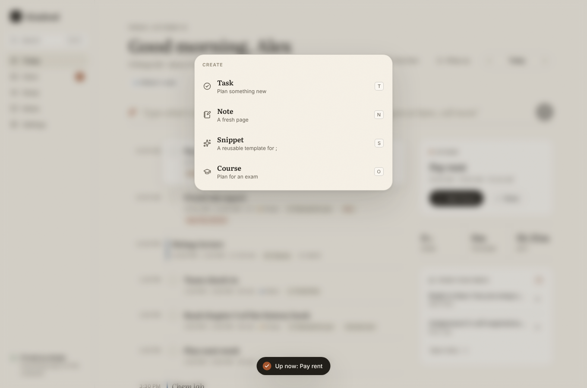
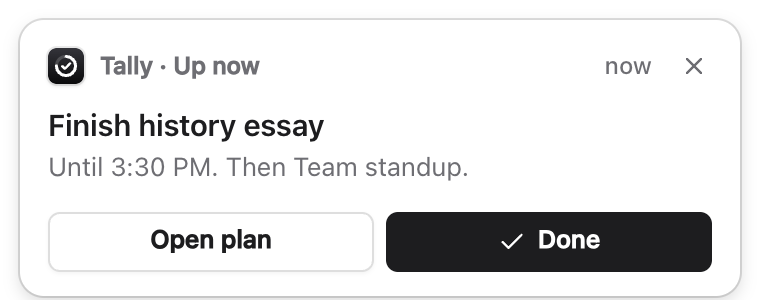
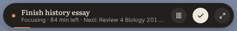

# Kindred

**Your day, planned for you.** Kindred is a calm desktop app for macOS and Windows that turns a quick brain dump, your inbox and your courses into a realistic daily plan, then keeps that plan on track as your day changes.

Everything runs on your computer. There is no account, no cloud and no tracking.



## What it does

- **Brain dump → plan.** Type something like `finish history essay by friday, gym at 6pm, call mom tomorrow` and Kindred works out the tasks, how long each takes, any fixed times and deadlines, then fits them into your day. Add `#tags`, and mark priority with `!` (high) or `!!` (urgent).
- **A plan that fixes itself.** Running late or skipped something? The rest of the day reflows around your calendar, urgent work goes first, and breaks are added after long stretches. Unfinished work moves to tomorrow and shows up in your inbox as "carried over", so nothing silently piles up.
- **Your calendar, privately.** Paste your calendar's iCal link (Google, iCloud, Outlook or a school portal). Classes and meetings, including weekly repeats, become fixed blocks that Kindred plans around. No account sign-in needed.
- **One inbox for everything.** Email, carried-over tasks, tasks written in notes, flashcards that are due and study not yet planned, all in one list split into **Signal** (needs you) and **Noise** (can wait), grouped by day, with a reading pane. Press `j`/`k` to move, `space` to preview, `e` for done, `a` to accept.
- **Email that turns into tasks.** Connect Gmail, iCloud, Yahoo, Fastmail or any IMAP account. Deadlines and requests become task suggestions, and replies are drafted for you.
- **Copy my free time.** One click turns your open time over the next few days into a message you can paste into a reply.
- **Now Bar and reminder cards.** A floating pill shows what to do right now, on top of any app, and Kindred's own notification card appears when a task begins or a focus session ends, with *Start focus*, *Done* and *10 more min* buttons.
- **Study.** Add a course, its exam date and its topics. Kindred spreads the work across your days, makes flashcards from your own notes, and quizzes you with spaced repetition.
- **Notes and snippets.** A quiet, paper-like place to write. Lines that start with `[ ]` or `/task` become tasks, `#tags` link notes to tasks, and typing `;` inserts a template (lecture notes, meeting notes, weekly review…).
- **Keyboard first.** `⌘K`/`Ctrl K` searches everything (try `#bio`), `c` opens the create launcher (`c` `t` task, `c` `n` note, `c` `s` snippet, `c` `o` course), `g` then `t`/`i`/`s`/`n` switches pages, `p` changes priority, `f` starts focus, `?` shows them all.
- **Paper and night reading.** A warm, Kindle-like paper theme with the Literata book typeface, and a matching dark mode.

| Unified inbox | Snippets | Free time |
| --- | --- | --- |
|  |  |  |

| Night reading | Create launcher | Reminder card |
| --- | --- | --- |
|  |  |  |



## Run it on your computer

### 1. Install the tools (one time)

**macOS**

```bash
xcode-select --install                                           # Apple's command line tools
curl --proto '=https' --tlsv1.2 -sSf https://sh.rustup.rs | sh   # Rust (press Enter for defaults)
brew install node                                                # Node.js 20+ (or download it from nodejs.org)
```

**Windows** (PowerShell)

```powershell
winget install Microsoft.VisualStudio.2022.BuildTools --override "--wait --passive --add Microsoft.VisualStudio.Workload.VCTools --includeRecommended"
winget install Rustlang.Rustup
winget install OpenJS.NodeJS.LTS
```

Then close and reopen your terminal. Windows 10 and 11 already include WebView2, which Kindred uses to draw its windows.

### 2. Get the code and start the app

```bash
git clone https://github.com/BryanParreira/kindred.git
cd kindred
npm install
npm run app:dev
```

The first start compiles the Rust side, which takes a few minutes. Later starts take seconds.

### 3. Build an installer

```bash
npm run app:build
```

| Platform | Where the installer ends up |
| --- | --- |
| macOS | `src-tauri/target/release/bundle/dmg/Kindred_0.1.0_*.dmg` |
| Windows | `src-tauri\target\release\bundle\nsis\Kindred_0.1.0_x64-setup.exe` (and an `.msi`) |

For a single Mac build that runs on both Apple Silicon and Intel:
`rustup target add aarch64-apple-darwin x86_64-apple-darwin && npm run app:build -- --target universal-apple-darwin`

Every push to `main` also builds the macOS and Windows installers on GitHub Actions. Download them from the run's **Artifacts** section. Pushing a tag like `v0.1.0` publishes them as a GitHub Release.

> **Unsigned builds:** until the app is code-signed, macOS will say it "can't be opened". Right-click Kindred in Applications → **Open** → **Open**. On Windows, SmartScreen may show "Windows protected your PC": click **More info** → **Run anyway**.

### Try just the interface in a browser

```bash
npm run dev    # then open http://localhost:1420
```

Everything except email, the Now Bar and the reminder cards works in the browser preview, and data is kept in browser storage.

## Connecting email

Kindred connects directly from your computer to your provider over IMAP. Your password is stored in your system's secure keychain (Keychain on macOS, Credential Manager on Windows), never in Kindred's data file.

Most providers need an **app password** rather than your normal password:

- **Gmail:** turn on 2-Step Verification, then create one at <https://myaccount.google.com/apppasswords>.
- **iCloud:** account.apple.com → Sign-In and Security → App-Specific Passwords.
- **Yahoo / Fastmail:** create an app password in the account's security settings.

Outlook.com and Microsoft 365 require Microsoft's own sign-in, which isn't supported yet.

## Connecting a calendar

Settings → **Calendars** → paste the calendar's private iCal link:

- **Google Calendar:** Settings → your calendar → Integrate calendar → *Secret address in iCal format*.
- **iCloud:** Calendar app → right-click the calendar → Share → *Public Calendar* → copy the link.
- **Outlook:** Settings → Calendar → Shared calendars → *Publish a calendar* → ICS link.
- **Canvas, Moodle, Blackboard:** look for "Calendar feed".

Kindred downloads the link straight from your provider every 30 minutes. Calendars are read-only in Kindred.

## Where your data lives

| Platform | Location |
| --- | --- |
| macOS | `~/Library/Application Support/app.kindred.desktop/kindred-data.json` |
| Windows | `%APPDATA%\app.kindred.desktop\kindred-data.json` |

Settings → **Erase everything** deletes it, including the saved email password.

## Development

```bash
npm test                                         # planner, parser, email and study logic
npm run typecheck
cargo test --manifest-path src-tauri/Cargo.toml  # native side (email parsing)
```

| Path | What's there |
| --- | --- |
| `src/lib/parse.ts` | Brain-dump parser: times, durations, deadlines, categories |
| `src/lib/schedule.ts` | The self-healing day planner |
| `src/lib/mail.ts` | Signal/noise and email → task suggestions, reply drafts |
| `src/lib/study.ts` | Flashcards from notes, spaced repetition, study pacing |
| `src/lib/notes.ts` | `[ ]` and `/task` lines in notes → tasks |
| `src/lib/ics.ts` | Calendar (.ics) reader: time zones, repeating events, exceptions |
| `src/lib/triage.ts` | The unified Signal/Noise inbox |
| `src/lib/availability.ts` | "Copy my free time" |
| `src/views/`, `src/components/` | The interface (React) |
| `src/nowbar.tsx`, `src/notice.tsx` | The floating Now Bar and reminder card windows |
| `src-tauri/src/` | Native shell (Tauri/Rust): windows, tray, global shortcut, storage, IMAP |

Built with [Tauri 2](https://tauri.app), React and TypeScript.

## Credits

The unified Signal/Noise inbox, keyboard model, create launcher, tags and snippets were inspired by [Macro](https://github.com/macro-inc/macro), an open-source team workspace. Kindred is an independent implementation for one person, running on their own computer. It contains no code from Macro.
