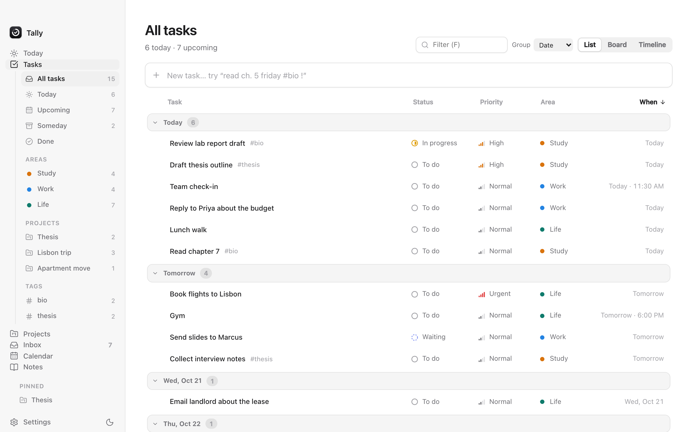
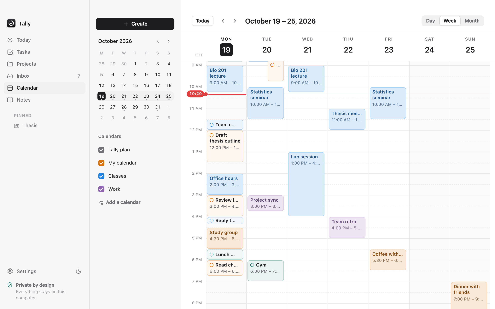
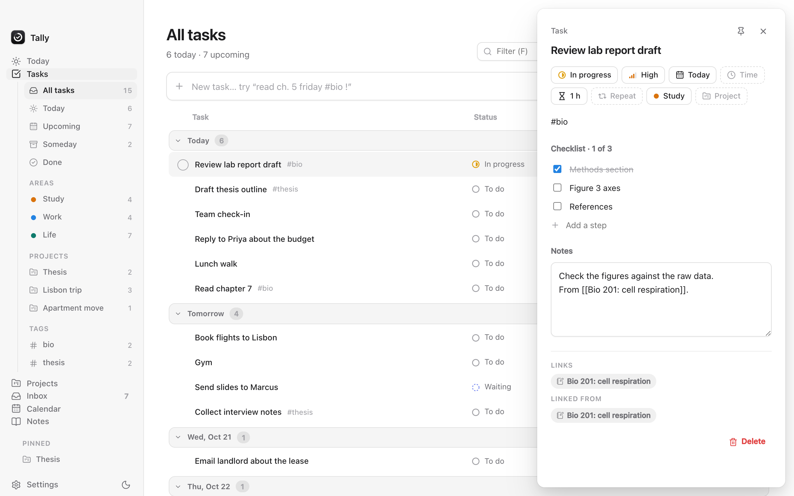
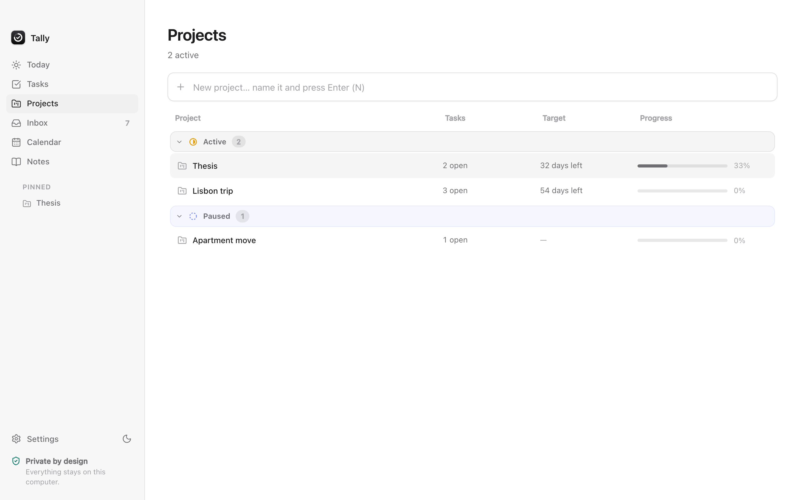
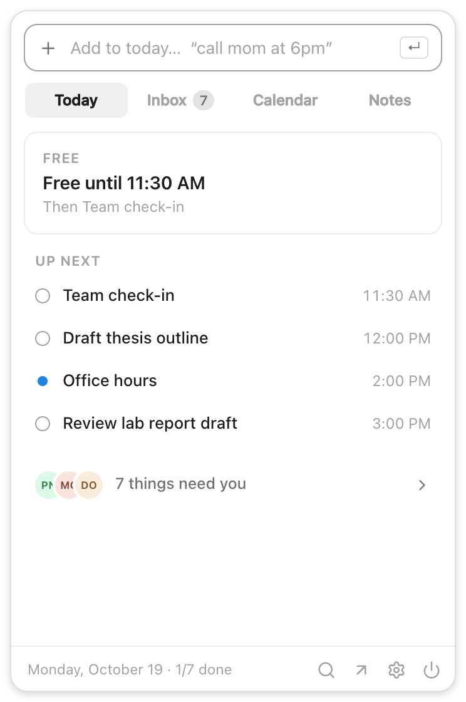
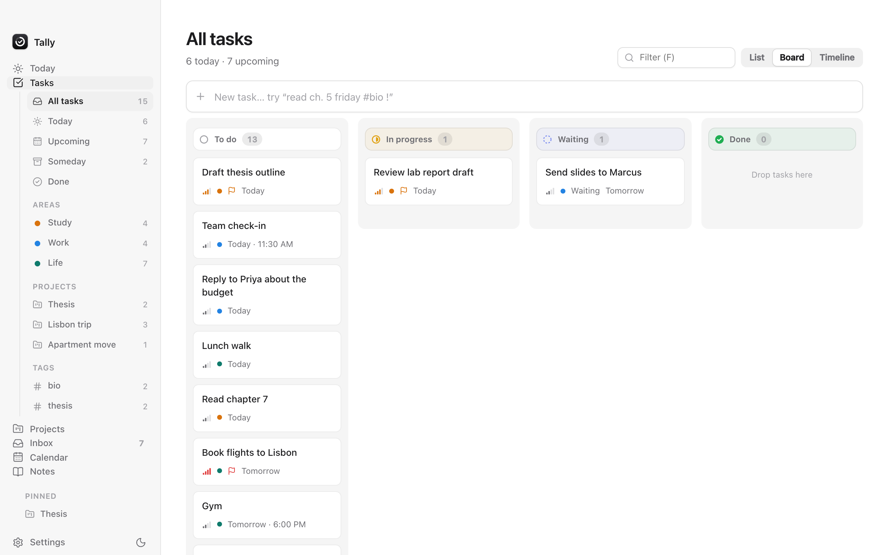
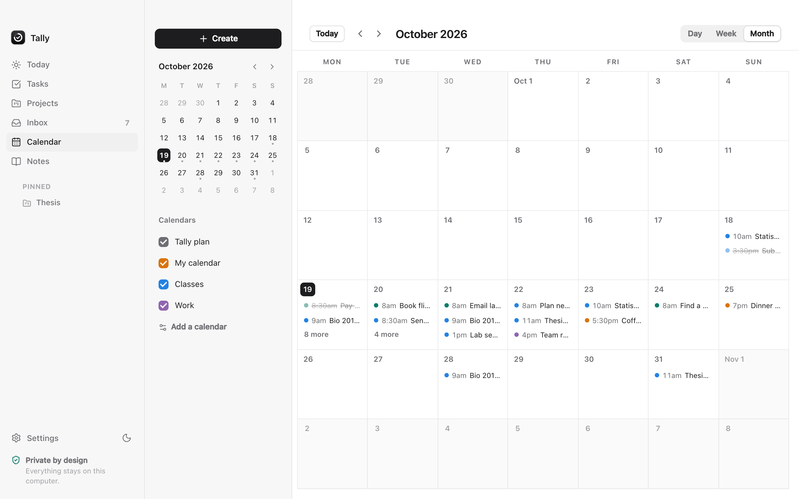

<p align="center">
  
</p>

<h1 align="center">Tally</h1>

<p align="center">
  Your day, planned for you.<br>
  A calm desktop planner for macOS and Windows. No account, no cloud, no tracking.
</p>

<p align="center">
  <a href="#quick-start">Quick start</a> &nbsp;·&nbsp;
  <a href="#whats-inside">What's inside</a> &nbsp;·&nbsp;
  <a href="#keyboard">Keyboard</a> &nbsp;·&nbsp;
  <a href="#run-it-on-your-computer">Install</a>
</p>

<br>

<p align="center">
<picture>
  <source media="(prefers-color-scheme: dark)" srcset="docs/today-dark.png">
  
</picture>
</p>

<br>

## Why Tally

Most planners ask you to do the planning. Tally takes a brain dump, your inbox and your calendar and builds a realistic day, then rebuilds it when the day changes.

**One loop.** Everything arrives in the Inbox. You decide once: today, later, wait, or done. Today shows a plan that fits around your calendar.

**A plan that fixes itself.** Running late? The rest of the day reflows, urgent work goes first, and unfinished tasks carry over instead of piling up.

**Private by design.** Mail and calendars are read straight from your provider. The assistant runs on your computer. Nothing is stored anywhere else.

**Keyboard first.** `⌘K` finds anything, `c` creates, `g` then a letter goes anywhere.

<br>

## What's inside

### Today

Your tasks beside your day. Type `finish essay by friday, gym at 6pm, call mom tomorrow` and Tally works out the times, lengths and deadlines. A Now card shows what's on, one quiet line points to what's pressing, and a short morning and evening check keeps you oriented.

### Tasks and projects

A table with status, priority and area, grouped and sorted how you like. See it as a list, a board or a four-week timeline. Group bigger efforts into **projects**, each with a target date and a progress bar. Properties change from small menus, not forms.

<p align="center">
<picture>
  <source media="(prefers-color-scheme: dark)" srcset="docs/tasks-dark.png">
  
</picture>
</p>

### Inbox

Several inboxes in one list, split into what needs you and what can wait. One decision per email: **Today**, **Schedule**, **Wait** or **Done**. Click a sender to see everything with them: their mail, plus the tasks and notes that mention them.

<p align="center">
<picture>
  <source media="(prefers-color-scheme: dark)" srcset="docs/inbox-dark.png">
  
</picture>
</p>

### Calendar

Day, week and month views. Apple and CalDAV accounts, or any calendar by link. Planned tasks sit beside your events. Drag to create, move or resize.

<p align="center">
<picture>
  <source media="(prefers-color-scheme: dark)" srcset="docs/calendar-dark.png">
  
</picture>
</p>

### Notes, links and the assistant

Write notes with `[ ]` task lines, `#tags` and `;` templates. Type `[[` to link a note, task or email, and every page shows what links back. Press `⌘J` to ask Tally to plan your day, sum up your inbox or answer from your own notes. It runs on your computer with [llama.cpp](https://github.com/ggml-org/llama.cpp) and NVIDIA's Nemotron 3 Nano (4B), so nothing you ask leaves your machine.

<br>

<details>
<summary><b>More screenshots</b></summary>

<br>

| Task details | Projects |
| :--- | :--- |
| <picture> <source media="(prefers-color-scheme: dark)" srcset="docs/task-detail-dark.png">  </picture> | <picture> <source media="(prefers-color-scheme: dark)" srcset="docs/projects-dark.png">  </picture> |

| Tray panel | Reminder card |
| :--- | :--- |
|  |  |

| Board | Month |
| :--- | :--- |
|  |  |

| Snippets | Free time | Create |
| :--- | :--- | :--- |
|  |  |  |

<sub>Screenshots use invented sample data.</sub>

</details>

<details>
<summary><b>Everything else Tally does</b></summary>

<br>

- **Tray panel.** A small panel from the menu bar or taskbar with Today, Inbox, Calendar and Notes, plus quick add.
- **Reminder cards.** A small card when a task or event begins, with *Done* or *Open calendar*.
- **Copy my free time.** One click turns your open hours into text for a reply.
- **Checklists and repeats.** Steps inside tasks, and "every monday".
- **Import.** Bring tasks in from Todoist, CSV or calendar to-dos.
- **Pinned.** Pin a task, note or project to keep it in the sidebar.
- **Backups.** Export everything to one file and restore it later. Every delete can be undone.
- **Light and dark.** Follows your system, or one click to switch.

</details>

<br>

## Keyboard

| | |
| :--- | :--- |
| `⌘K` or `/` | Find anything, or type a command |
| `c` then `t` `n` `s` | Create a task, note or snippet |
| `g` then `h` `t` `p` `i` `r` `n` | Go to Today, Tasks, Projects, Inbox, Calendar or Notes |
| `j` `k` &nbsp; `e` &nbsp; `p` &nbsp; `s` | Move, finish, change priority, change status |
| `⌘J` | Ask Tally |
| `⌘.` | Fold the sidebar |
| `?` | Show every shortcut |

<br>

## Quick start

```bash
git clone https://github.com/BryanParreira/tally.git
cd tally
npm install
npm run app:dev
```

You need Rust and Node.js. The full setup, installers and updates are below.

<br>

---

## Run it on your computer

### 1. Install the tools (one time)

**macOS**

```bash
xcode-select --install                                           # Apple's command line tools
curl --proto '=https' --tlsv1.2 -sSf https://sh.rustup.rs | sh   # Rust (press Enter for defaults)
brew install node                                                # Node.js 20+ (or download it from nodejs.org)
```

**Windows** (PowerShell)

```powershell
winget install Microsoft.VisualStudio.2022.BuildTools --override "--wait --passive --add Microsoft.VisualStudio.Workload.VCTools --includeRecommended"
winget install Rustlang.Rustup
winget install OpenJS.NodeJS.LTS
```

Then close and reopen your terminal. Windows 10 and 11 already include WebView2, which Tally uses to draw its windows.

### 2. Get the code and start the app

```bash
git clone https://github.com/BryanParreira/tally.git
cd tally
npm install
npm run app:dev
```

The first start compiles the Rust side, which takes a few minutes. Later starts take seconds.

### 3. Build an installer

```bash
npm run app:build
```

| Platform | Where the installer ends up |
| --- | --- |
| macOS | `src-tauri/target/release/bundle/dmg/Tally_0.1.0_*.dmg` |
| Windows | `src-tauri\target\release\bundle\nsis\Tally_0.1.0_x64-setup.exe` (and an `.msi`) |

For a single Mac build that runs on both Apple Silicon and Intel:
`rustup target add aarch64-apple-darwin x86_64-apple-darwin && npm run app:build -- --target universal-apple-darwin`

Every push to `main` also builds the macOS and Windows installers on GitHub Actions. Download them from the run's **Artifacts** section. Pushing a tag like `v0.1.0` publishes them as a GitHub Release.

> **Unsigned builds:** until the app is code-signed, macOS will say it "can't be opened". Right-click Tally in Applications → **Open** → **Open**. On Windows, SmartScreen may show "Windows protected your PC": click **More info** → **Run anyway**.

### Automatic updates

Installed copies of Tally check GitHub Releases for a newer version a few seconds after launch and every six hours. Under Settings → General → Updates you choose **Automatic** (installs by itself shortly after Tally opens), **Ask me** (offers the update) or **Off**. Updates are signed, and the app refuses any download whose signature doesn't match the public key in `src-tauri/tauri.conf.json`.

To publish an update:

1. One time: add the signing key to the repo's **Settings → Secrets and variables → Actions**:
   - `TAURI_SIGNING_PRIVATE_KEY`: the contents of `~/.tauri/tally.key` (create one with `npx tauri signer generate -w ~/.tauri/tally.key`, then paste the printed public key into `plugins.updater.pubkey` in `src-tauri/tauri.conf.json`) (keep this file safe and private; without it you can't ship updates)
   - `TAURI_SIGNING_PRIVATE_KEY_PASSWORD`: leave empty unless you set one
   - `TALLY_MS_CLIENT_ID`: your Microsoft app ID, so Outlook sign-in is built in
2. Bump `version` in `package.json` and `src-tauri/tauri.conf.json`, commit, then tag and push: `git tag v0.2.0 && git push --tags`.
3. GitHub Actions builds macOS and Windows, signs them, and publishes the release with `latest.json`. Every installed copy picks it up.

### The built-in assistant's model

The engine ([llama.cpp](https://github.com/ggml-org/llama.cpp), via the `llama-cpp-2` crate) is compiled into Tally; building needs `cmake` and a C++ compiler (Xcode tools on macOS, Visual Studio Build Tools on Windows). On Apple Silicon it runs on the GPU through Metal.

The model is [NVIDIA-Nemotron-3-Nano-4B](https://huggingface.co/nvidia/NVIDIA-Nemotron-3-Nano-4B-GGUF) (Q4_K_M, 2.8 GB). By default Tally downloads it once after first launch into its data folder, with a progress bar in Settings, resume after interruption and a **Remove model** button. To ship it inside the installer instead, put `NVIDIA-Nemotron3-Nano-4B-Q4_K_M.gguf` in `src-tauri/models/` before `npm run app:build`. Note that GitHub Releases limit each file to 2 GB, so a bundled installer can't be published there; that's why downloading is the default.

Check it on your machine: `TALLY_TEST_MODEL=/path/to/model.gguf cargo test --manifest-path src-tauri/Cargo.toml ai:: -- --ignored --nocapture`.

### Try just the interface in a browser

```bash
npm run dev    # then open http://localhost:1420
```

Everything except email and the reminder cards works in the browser preview, and data is kept in browser storage.

## Connecting email

Tally connects directly from your computer to your provider over IMAP. Your password is stored in your system's secure keychain (Keychain on macOS, Credential Manager on Windows), never in Tally's data file.

Most providers need an **app password** rather than your normal password:

- **Gmail:** turn on 2-Step Verification, then create one at <https://myaccount.google.com/apppasswords>.
- **iCloud:** account.apple.com → Sign-In and Security → App-Specific Passwords.
- **Yahoo / Fastmail:** create an app password in the account's security settings.

### Outlook, Hotmail and school Microsoft 365 accounts (like @minnstate.edu)

These use **Sign in with Microsoft**: Tally opens your browser, you sign in (including your school's two-step check), and Microsoft gives Tally read-only access to your mail. Mail is read through Microsoft Graph straight to your computer; the sign-in token is kept in your system keychain.

This needs Tally to be registered with Microsoft once (free, about 5 minutes):

1. Sign in to <https://entra.microsoft.com> (any Microsoft account works) → **Applications → App registrations → New registration**.
2. Name: `Tally`. Supported account types: **Accounts in any organizational directory and personal Microsoft accounts**.
3. Redirect URI: platform **Public client/native (mobile & desktop)**, value `http://localhost`. Register.
4. **API permissions → Add a permission → Microsoft Graph → Delegated**: add `Mail.Read`, `User.Read` and `offline_access`.
5. Copy the **Application (client) ID** from the Overview page.
6. Give Tally the ID: paste it in **Settings → Email → Microsoft sign-in** (no restart needed). For a build you share, set `TALLY_MS_CLIENT_ID` when building so it's included in the installer, and people don't need to paste anything. `TALLY_MS_CLIENT_ID=<your id> npm run app:dev` also works.

Some schools only allow apps their IT team has approved. If a student sees "Your school needs to approve Tally", the school's IT can grant consent for the app once for everyone. Completing Microsoft's publisher verification makes this much less likely.

## Connecting a calendar

Settings → **Calendars** offers three ways:

**Apple iCloud & CalDAV** (Apple Calendar, Fastmail, Nextcloud…): sign in with your account email and an *app-specific password*. For iCloud, create one at account.apple.com → Sign-In and Security → App-Specific Passwords. Tally finds all your calendars, keeps the password in your system keychain, and only ever reads from your provider.

**Calendar link** (Google, Outlook, school portals): paste the private iCal link:

- **Google Calendar:** Settings → your calendar → Integrate calendar → *Secret address in iCal format*.
- **iCloud:** Calendar app → right-click the calendar → Share → *Public Calendar* → copy the link.
- **Outlook:** Settings → Calendar → Shared calendars → *Publish a calendar* → ICS link.
- **Brightspace (D2L):** Calendar → Subscribe → "All courses" → copy the link.
- **Canvas, Moodle, Blackboard:** look for "Calendar feed".

Brightspace, Canvas and other course links turn on **Course calendar** automatically: assignment deadlines go to Tasks with their due date (planned the day before), classes and exams stay on the calendar, and "quiz opens" markers are skipped. If the teacher moves a deadline, the task follows. Delete one and it stays deleted.

**Import a file**: choose an `.ics` file exported from any calendar app.

Tally refreshes connected calendars every 30 minutes. Subscribed calendars are read-only in Tally; events you create live in *My calendar*, on your computer.

## Where your data lives

| Platform | Location |
| --- | --- |
| macOS | `~/Library/Application Support/app.tally.desktop/tally-data.json` |
| Windows | `%APPDATA%\app.tally.desktop\tally-data.json` |

Settings → **Erase everything** deletes it, including the saved email password.

## Development

```bash
npm test                                         # planner, parser, email, links, search and project logic
npm run typecheck
cargo test --manifest-path src-tauri/Cargo.toml  # native side (email parsing)
```

| Path | What's there |
| --- | --- |
| `src/lib/parse.ts` | Brain-dump parser: times, durations, deadlines, categories |
| `src/lib/schedule.ts` | The self-healing day planner |
| `src/lib/mail.ts` | Signal/noise and email → task suggestions, reply drafts |
| `src/lib/links.ts` | `[[links]]`, backlinks and rename-safe links |
| `src/lib/search.ts` | Local recall: ranks notes, tasks and mail for the assistant |
| `src/lib/contacts.ts` | The person view: mail, tasks and notes for one sender |
| `src/lib/projects.ts` | Project progress and dates |
| `src/lib/suggest.ts` | The single "Next" line on Today |
| `src/lib/notes.ts` | `[ ]` and `/task` lines in notes → tasks |
| `src/lib/ics.ts` | Calendar (.ics) reader: time zones, repeating events, exceptions |
| `src/lib/courses.ts` | Course feeds: splits classes from assignment deadlines and keeps those tasks in sync |
| `src/lib/caldav.ts` | CalDAV client (Apple iCloud, Fastmail, Nextcloud) |
| `src/views/calendar/` | Day, week and month calendar |
| `src/tray.tsx` | The tray panel |
| `src/lib/triage.ts` | The unified Signal/Noise inbox |
| `src/lib/availability.ts` | "Copy my free time" |
| `src/lib/taskViews.ts` | Task views, filters and grouping |
| `src/views/`, `src/components/` | The interface (React) |
| `src/notice.tsx` | The reminder card window |
| `src-tauri/src/` | Native shell (Tauri/Rust): windows, tray, global shortcut, storage, IMAP |

Built with [Tauri 2](https://tauri.app), React and TypeScript.

## Credits

The way Tally works (the unified Signal/Noise inbox, Tasks list and board, keyboard navigation, create launcher, tags and snippets) was inspired by [Macro](https://github.com/macro-inc/macro), an open-source team workspace. Tally is an independent implementation for one person, running on their own computer. It contains no code from Macro.
